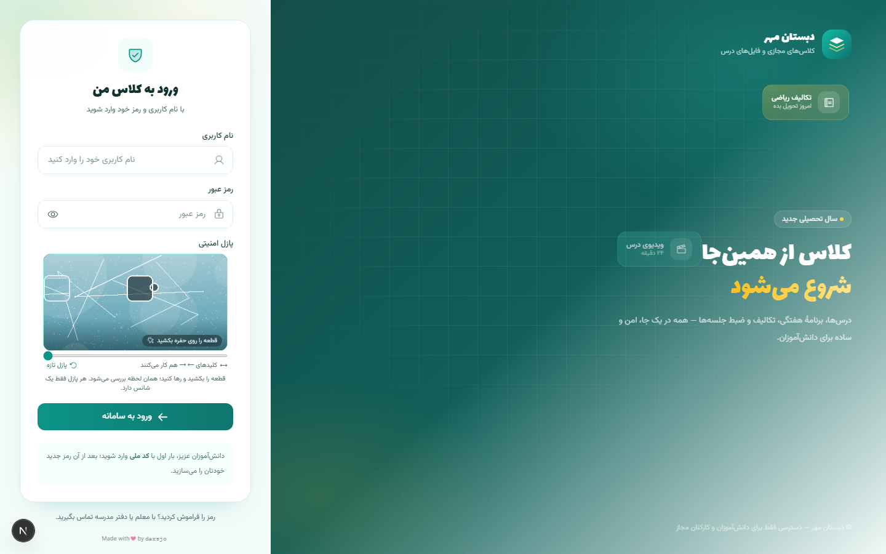
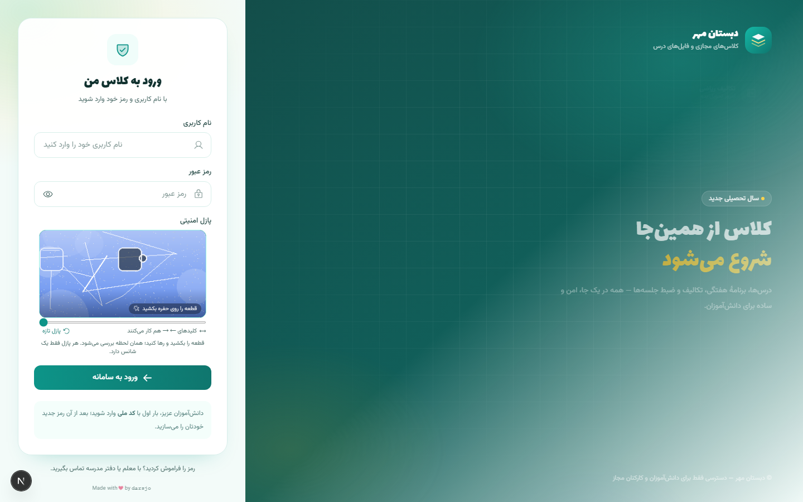
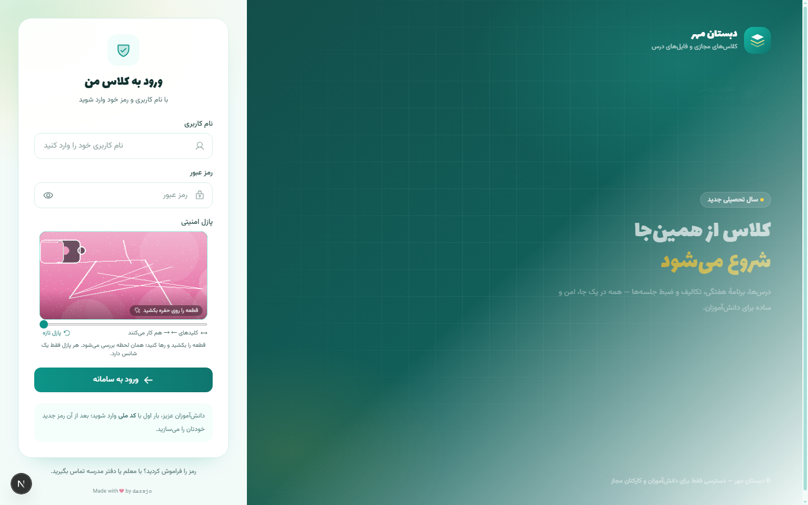
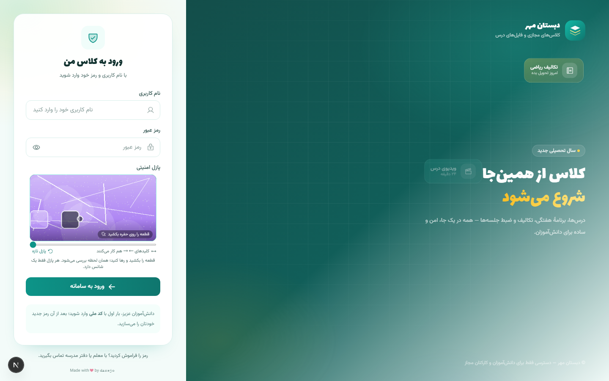
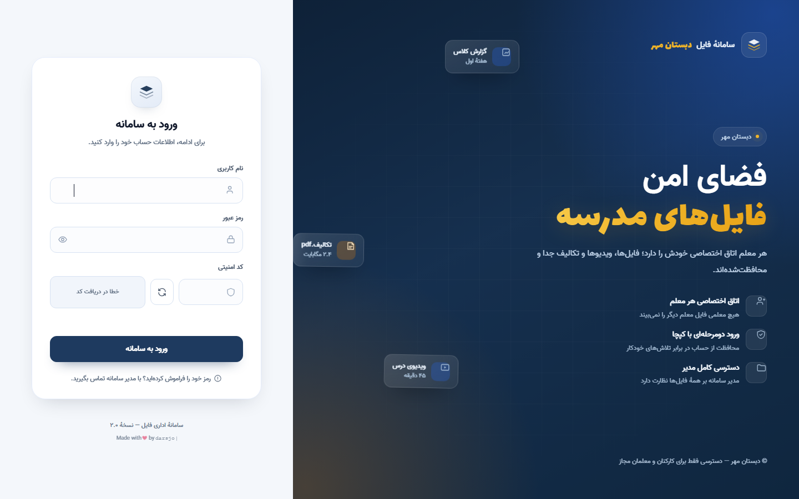
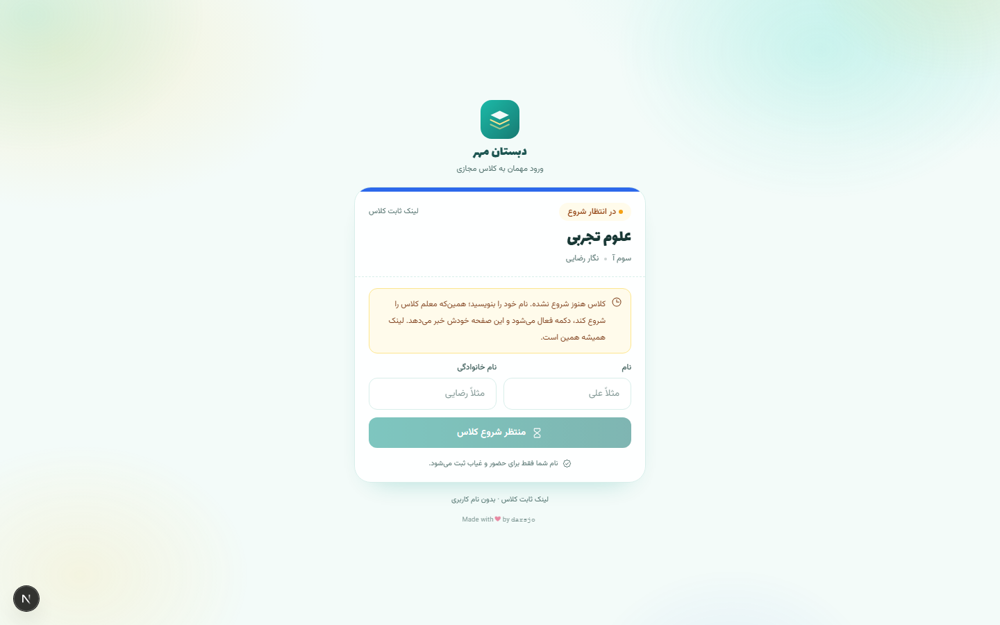

# درس‌جو

سامانهٔ کلاس آنلاین مدرسه که روی سرور خودم اجرا می‌شود. سه قطعهٔ اصلی دارد: کلاس مجازی روی BigBlueButton، پنل فایل معلم‌ها و یک API مرکزی که این دو را به هم وصل می‌کند.

این ریپو نسخهٔ عمومی و تمیزشدهٔ پروژه است؛ دامنه‌ها و اسم مدرسهٔ واقعی با مقادیر نمونه عوض شده و داده‌های دیتابیس هم فیک است.

## چه چیزی اینجا هست

`backend` — Django و DRF. مدل‌های کاربر/کلاس/درس/جلسه، اتصال به BBB، همگام‌سازی ضبط‌ها، گزارش فعالیت و یک سرور FTP امن برای معلم‌ها.

`frontend` — Next.js 15. پنل مدیریت، صفحهٔ درس با جلسه‌های شماره‌دار و لینک ثابت ورود دانش‌آموز، صفحهٔ ورود مهمان با کپچای کشیدنی.

`portal` — پنل فایل مدرسه با Node.js. هر معلم فقط پوشهٔ خودش را می‌بیند، آپلود حجیم با chunk، quota، بکاپ و پخش ویدیو.

`deploy` — اسکریپت‌های استقرار روی سرور لینوکسی: nginx، systemd timers برای همگام‌سازی ضبط و پاک‌سازی لاگ، نصب FTP.

## چطور کار می‌کند

معلم از پنل وارد می‌شود، برای هر جلسه یک شماره می‌زند (شماره فقط برای ضبط و تاریخ است) و دکمهٔ شروع کلاس را می‌زند. اتاق همان لحظه در BBB ساخته می‌شود و لینک ثابت کلاس برای دانش‌آموزان باز می‌شود. دانش‌آموز لینک را که باز کند فقط نام و نام خانوادگی‌اش را می‌نویسد و به‌عنوان بیننده وارد می‌شود — بدون حساب کاربری. با پایان جلسه لینک قفل می‌شود تا جلسهٔ بعد.

ضبط دستی است؛ معلم داخل اتاق دکمهٔ ضبط BBB را می‌زند. بعد از پایان کلاس، یک تایمر systemd هر پنج دقیقه ضبط‌های منتشرشده را از BBB می‌گیرد، به همان شمارهٔ جلسه می‌چسباند و در فهرست درس نشایش می‌دهد. اگر جلسه‌ای ضبط داشته باشد، دفعهٔ بعد اتاق بدون امکان ضبط باز می‌شود تا هر جلسه فقط یک ضبط داشته باشد.

مدیر کل سامانه را از یک داشبورد می‌بیند؛ کاربرها، کلاس‌ها، درس‌ها و ایمپورت گروهی دانش‌آموزان با اکسل. هر ورود و اقدام مهم در گزارش فعالیت با IP و شناسهٔ درخواست ثبت می‌شود و ردیف‌های قدیمی‌تر از یک هفته خودکار پاک می‌شوند.

## پنل فایل و ارتباطش با کلاس

هر معلم یک پوشهٔ اختصاصی روی سرور دارد که هم از مرورگر (پنل فایل) و هم با FTP روی TLS قابل دسترسی است. حساب معلم موقع ساخت در LMS، خودکار در دیتابیس پنل هم ساخته می‌شود؛ رمز یکسان است اما هش‌های جدا دارند. ارتباط دو سرویس با یک درخواست داخلی امضاشده (HMAC-SHA256) انجام می‌شود که هیچ‌وقت از بیرون شبکه قابل فراخوانی نیست.

ضبط‌های جلسه‌ها هم در پنل فایل کنار فایل‌های درس دیده می‌شوند؛ لینک تماشا از BBB و لینک دانلود یک توکن امضاشده از LMS است که بعد از چند دقیقه منقضی می‌شود.

## ورود مهمان

لینک ثابت هر کلاس یک توکن تصادفی است که همهٔ سال ثابت می‌ماند. صفحهٔ ورود مهمان تا وقتی معلم کلاس را شروع نکرده حالت انتظار دارد و خودش هر هفت ثانیه وضعیت را چک می‌کند. نام مهمان‌ها فقط برای حضور و غیاب همان جلسه ذخیره می‌شود و توکن هیچ دسترسی‌ای به فایل‌ها یا ضبط‌ها نمی‌دهد.

## اجرای محلی

به‌جز درایورهای استقرار، همه‌چیز با Docker Compose بالا می‌آید: `backend` روی Gunicorn و `frontend` روی Node. PostgreSQL و BBB سرویس‌های بیرونی هستند و آدرس‌شان را از متغیرهای محیطی می‌خوانند (`config/settings.py` مرجع کامل است). برای پنل فایل هم `portal` یک سرویس systemd جدا است.

تست‌ها با `python manage.py test` اجرا می‌شوند؛ فولدر `backend/tests` حدود ۱۰۸ تست دارد که منطق دسترسی‌ها، شماره‌گذاری جلسه‌ها، یکتایی ضبط و کپچا را پوشش می‌دهد.

## یادداشت

این پروژه برای نیازهای واقعی یک مدرسه ساخته شده و هنوز در حال استفاده است؛ پس بعضی تصمیم‌ها (مثل ضبط دستی یا قفل‌شدن لینک بین جلسه‌ها) عمداً محافظه‌کارانه است. اگر چیزی خواستی تغییر بدهی، اول `/docs` و کامنت‌های داخل کد را بخوان که چرا آن‌جا آن‌طور نوشته شده.
